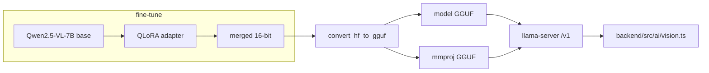

# VACA vision model — fine-tune Qwen2.5-VL-7B

Plan + scripts to give VACA a **native multimodal model**: Qwen2.5-VL-7B-Instruct,
QLoRA fine-tuned on VACA's image + text data, exported to GGUF (+ mmproj) and
served on an OpenAI-compatible `/v1` endpoint that `backend/src/ai/vision.ts`
already knows how to call.

This replaces the "external captioner" arrangement, where images are sent to a
*separate* model (`vaca-vision-r3`) and only its text ever reaches the LLM.

---

## 0. Why Qwen2.5-VL and not "convert the R20 Coder"

The shipped model is `models/Qwen2.5-Coder-14B-Instruct-Uncensored.R20.Q4_K_M.gguf`.
It **cannot** be converted to multimodal:

- It is a **4-bit GGUF** — an inference-only artifact. You cannot backprop
  through it; training must happen on bf16/fp16 safetensors.
- Qwen2.5-Coder has **no vision tower and no projector**. Multimodal is a graft
  (encoder + projector + trained connector), not a flag.
- Qwen already ships the multimodal sibling: **Qwen2.5-VL**, with the vision
  tower, projector and image-token vocab trained. Start there.



---

## 1. How hard and how long is this?

Honest tiers, measured against **this** machine (RTX 3060 **12 GB**, ~**22 GB**
free disk — both are binding constraints):

| Goal | Difficulty | Time | Runs here? |
|---|---|---|---|
| Fine-tune an existing small **text** model (QLoRA 3–7B) | Low | hours | ✅ (what the repo already does) |
| Fine-tune **Qwen2.5-VL-7B** (this plan) | Medium | **1–3 days of GPU** + **days–weeks of data work** | ⚠️ training maybe; **merge/export no** |
| Train a **tiny LLM from scratch** (~10–150M params) | Medium–high | days–weeks engineering, hours compute | ✅ but toy-grade only |
| Train a **useful 1–7B LLM from scratch** | Very high | **months**, $100k–millions, billions of tokens | ❌ |

The dominant cost is **never the training run** — it is the **data**:

- A VLM projector needs roughly **10k–100k image↔text pairs** to be useful.
  LLaVA-style recipes use ~558k pretrain + ~665k instruct.
- This repo currently has **146 text records and 0 images**. The data step is
  the real project; the fine-tune is a few hours.

### Hardware reality check (verified on this box)

| Resource | Have | Need for 7B-VL QLoRA | Verdict |
|---|---|---|---|
| GPU VRAM | 12 GB | ~16 GB (seq 2048) | training only at seq ≤1024, slow |
| Disk free | 22 GB | ~16 GB merged fp16 + ~15 GB f16 + ~5 GB q4 | ❌ **blocker** |

➡️ **Do the merge + GGUF conversion on Colab/Kaggle**, not locally. Training can
run locally at `--max-seq-length 1024` but is ~3–6× slower than a T4.

---

## 2. What you need before starting

1. **Image data.** Any of:
   - screenshots of VACA-built UIs with a text description,
   - UI mockups → app descriptions,
   - **self-generated pairs**: run VACA's own exports through a screenshot step
     and pair each render with the blueprint that produced it (cheap, on-domain,
     unlimited).
2. A pairs manifest `data/vlm/pairs.jsonl`:
   ```json
   {"image": "shot-0001.png", "instruction": "Describe this UI and its layout.", "output": "..."}
   ```
3. The text corpora in `training/dataset/*.jsonl` are replayed automatically so
   the model does not forget VACA's text behaviour.

---

## 3. Pipeline (four commands)

### 3.1 Build the dataset

```bash
python3 training/vlm/build_vlm_dataset.py \
  --pairs data/vlm/pairs.jsonl --image-root data/vlm/images \
  --text-corpus training/dataset/train.jsonl \
  --text-corpus training/dataset/how-vaca-works.jsonl \
  --out-dir training/dataset/vlm
```
Emits `train/val/test.jsonl` + `vlm_dataset_meta.json`. Rows are the HF/Qwen2-VL
chat schema; image paths are **relative** so the same dataset works on Colab.
It **fails loudly** if an image is missing, and warns if there are zero image rows.

### 3.2 Fine-tune (QLoRA)

```bash
python3 training/vlm/train_qwen25vl_qlora.py --dataset training/dataset/vlm \
  --image-root data/vlm/images --out-dir training/vlm/out \
  --rounds 1 --lr 2e-4 --epochs 2 --max-seq-length 1024   # 12 GB card
```
Same conventions as `training/cloud/train_round1.py`: LoRA `r=8/α=16/dropout 0.05`,
batch 1, grad-accum 8, `adamw_8bit`, LR halved each round, adapter saved per round.
Add `--dry-run` to validate the dataset with **no GPU and no unsloth installed**.

`finetune_vision_layers=False` is deliberate — freezing the ViT is the single
biggest VRAM saving and still trains the language side to read image tokens.

### 3.3 Merge + export to GGUF (+ mmproj)

```bash
python3 training/vlm/export_vlm_gguf.py \
  --adapter training/vlm/out/adapter --merged-out training/vlm/out/merged \
  --out-dir training/vlm/out/gguf --llama-cpp ~/llama.cpp --quant q4_k_m
```
Three stages, mirroring the proven `scripts/build-r20-merged.py`:
1. **merge** → a real 16-bit safetensors dir (validated: >12 GB, no `quant_state`
   tensors, no `quantization_config`). A 4-bit "merge" is not a merge.
2. **convert** via llama.cpp → `model-f16.gguf` → `llama-quantize` → `model-Q4_K_M.gguf`,
   and the **`mmproj-*.gguf`** vision projector (a separate file).
3. **package** → `Modelfile-vaca-vision` + the serve command.

`--dry-run` prints the exact commands and checks free disk without writing.

### 3.4 Evaluate

```bash
python3 training/vlm/eval_vlm.py --dataset training/dataset/vlm \
  --image-root data/vlm/images --model vaca-vision-r3 \
  --base-url http://127.0.0.1:8000/v1 --json-out training/vlm/out/eval.json
```
Reports **image accuracy** (exact-match + token-F1) *and* **text retention** on
the same test split — so a fine-tune that broke VACA's text behaviour is visible
rather than silent. Run it against the untouched base too, to prove the
fine-tune actually helped.

---

## 4. Serving and wiring it into the app

`backend/src/ai/vision.ts` already:
- reads a `vision` section from `backend/llm-config.json`,
- defaults to model `vaca-vision-r3`,
- POSTs base64 images to an OpenAI-compatible `/v1` chat endpoint.

So **no code change is required** — only a server and a config entry.

**Robust path (recommended): llama-server**

```bash
llama-server -m training/vlm/out/gguf/merged-Q4_K_M.gguf \
             --mmproj training/vlm/out/gguf/mmproj-merged-f16.gguf \
             --host 0.0.0.0 --port 8000
```

Then in `backend/llm-config.json`:
```json
"vision": { "provider": "openai", "model": "vaca-vision-r3",
            "baseUrl": "http://127.0.0.1:8000/v1", "apiKey": "local" }
```

**Ollama path:** `models/Modelfile-vaca-vision` uses two `FROM` lines
(model + mmproj). This works for some architectures and **fails to load for
others** — treat it as a convenience, and fall back to llama-server if
`ollama create` errors.

> ⚠️ Keep the **chat template** identical between training and serving. A
> mismatched template is the #1 cause of "it worked in training, it's gibberish
> on Ollama".

---

## 5. The GGUF rebuild pipeline (both models)

This is the same shape for VACA's text model and the new vision model:

```
adapter (LoRA)  ──merge──▶  merged 16-bit safetensors  ──convert──▶  GGUF  ──quantize──▶  Q4_K_M
```

### Text model (R20) — what exists on disk today

| Stage | Artifact | Location | Present? |
|---|---|---|---|
| base | `BlossomsAI/Qwen2.5-Coder-14B-Instruct-Uncensored` | HF | pulled on demand |
| adapter | `adapter_round20` (r=8, α=16) | Kaggle kernel output | ❌ not local |
| merge | `training/cloud/out/round20/merged` | — | ❌ not local |
| GGUF | `Qwen2.5-Coder-14B-...R20.Q4_K_M.gguf` (8.9 GB) | `models/` | ✅ |
| served | `vaca-r20-q4` | Ollama `127.0.0.1:11434` | ✅ |

So the **trainable** R20 checkpoint is **not on this machine** — only the
finished GGUF. To rebuild it you need the `adapter_round20` dir re-downloaded
from Kaggle, then:

```bash
python3 scripts/build-r20-merged.py        # base + adapter -> merged_16bit (validates)
bash scripts/deploy-round20.sh             # merged -> q4_k_m GGUF -> DSpark/Ollama
ollama create vaca-r20-q4 -f models/Modelfile-r20
```
`build-r20-merged.py` already encodes the two traps worth remembering:
`merged_16bit` (not `merge_and_unload()`), and explicit `max_memory` so
bitsandbytes 4-bit does not spill to CPU.

### Vision model — scripts added here

`training/vlm/export_vlm_gguf.py` performs the same three stages for the VL
model, plus the `mmproj` projector export that a text model does not have.

---

## 6. Honest limitations

- **No image data exists yet.** Nothing here produces a working vision model
  until real image↔text pairs are added; the scripts will run and warn.
- **The local box cannot merge/export**: 22 GB free is below the ~36 GB peak.
  Train on Colab, merge/convert there too.
- **QLoRA does not add knowledge** — it teaches *behaviour/format* on data you
  provide. A 7B VL model will not magically know VACA's blueprints from 146 rows.
- **Serving the mmproj through Ollama is not guaranteed**; llama-server is.
- Exporting a VL model to GGUF is comparatively new; verify the `mmproj` was
  actually produced before trusting the export.
- Wiring these scripts into the CI gate (`scripts/check-training.sh` `PY_SCRIPTS`)
  is **not** done — add them if you want `npm run build` to syntax-gate them.

## Files

| File | What it is |
|---|---|
| `build_vlm_dataset.py` | Merge image pairs + text corpora into Qwen2.5-VL chat JSONL |
| `train_qwen25vl_qlora.py` | 4-bit QLoRA fine-tune, LR ladder, per-round adapters, `--dry-run` |
| `export_vlm_gguf.py` | Merge → GGUF + mmproj → Modelfile (3 stages, validated) |
| `eval_vlm.py` | Image accuracy + text-retention eval over any `/v1` endpoint |
| `requirements.txt` | Training-only dependencies |
| `../../models/Modelfile-vaca-vision` | Ollama serving template (`vaca-vision-r3`) |
